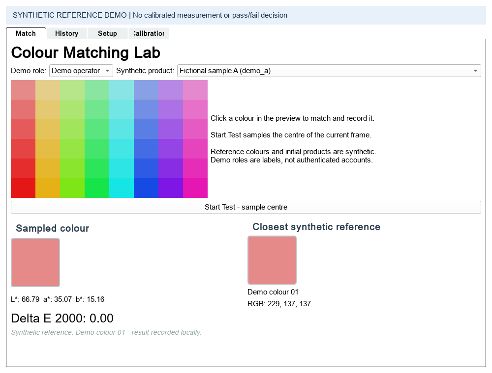

# Colour Matching Lab

A Python desktop prototype for exploring image-based colour comparison: sample a small region, convert sRGB to CIE L\*a\*b\*, and rank reference colours using CIEDE2000.

Visual colour checks are affected by lighting and human judgement. This project demonstrates a repeatable software workflow for sampling, comparison and per-product history. It is a portfolio demonstration, not a calibrated colour instrument or an automated quality acceptance system.



The included 56 reference colours and two initial products are **synthetic**. They are generated from an HSV grid and neutral RGB levels; they do not represent a commercial colour standard. Default operation is entirely local, without equipment, email or external service connections. Installing dependencies and running GitHub Actions require internet access.

## Run the demonstration

Use 64-bit Python **3.14** and Git. Local verification used Windows and Python 3.14.2. Other operating systems are not verified; the GUI requires a Qt-compatible desktop. Run these commands from this repository's root.

Windows PowerShell (activation is unnecessary):

```powershell
python -m venv .venv
.\.venv\Scripts\python.exe -m pip install -r requirements.txt
.\.venv\Scripts\python.exe demo.py --rgb 128 128 128
```

If `python` is unavailable, use `py -3.14` for the first command. The CLI prints JSON containing `synthetic-offline`, reference `Demo neutral 05`, reference RGB `[128, 128, 128]`, and a Delta E close to zero (floating point output may vary). It opens no window and writes no history.

Launch the desktop demo:

```powershell
.\.venv\Scripts\python.exe ui.py
```

1. Select a fictional product on the Match tab.
2. Click a colour inside the grid to sample it, or click **Start Test - sample centre** to sample the centre of the current frame.
3. Inspect the sampled Lab values, closest synthetic reference, RGB and Delta E.
4. Open History to see the locally recorded result. Setup can add, reload and remove demo products. Removing a product retains its history file.

On first launch, the GUI copies the synthetic product list to `runtime/products.csv`. Subsequent changes and per-product histories remain under `runtime/`, which Git ignores. Demo roles are history labels and provide no authentication. Calibration is an explicitly unimplemented information tab.

For an optional local webcam, explicitly opt in:

```powershell
.\.venv\Scripts\python.exe ui.py --camera-index 0
```

This opens only the selected webcam through OpenCV. The default command never probes cameras. Webcam results still use synthetic references and require calibration before any measurement use. Webcam hardware has not been tested for this portfolio copy.

For a Unix-like shell, the equivalent interpreter is `.venv/bin/python` after `python3.14 -m venv .venv`; this installation route has not been locally verified.

## Implementation and engineering decisions

- **Qt GUI and worker thread:** PyQt5 keeps preview acquisition in a `QThread`, with signals delivering frames to the main event loop. The resizable layout keeps the preview and results visible.
- **Shared matching core:** the CLI and GUI use `color_matching.py`, NumPy, pandas and colour-science. Reference CSVs are validated for required fields, unique names, finite values and RGB ranges before matching.
- **Sampling:** OpenCV frames are BGR. A clipped 5 by 5 pixel region is spatially averaged and reordered to RGB. sRGB is converted to XYZ and then Lab using D65; every reference is ranked with CIEDE2000. Equal distances use the first CSV row. There is no temporal frame averaging.
- **Transparent persistence:** CSV keeps this single-user prototype easy to inspect. History contains a local timestamp, demo role, product, sampled Lab, reference RGB/name and Delta E. The CLI is read-only.
- **Reproducible examples:** `generate_demo_library.py` produces the fictional references using the same conversion pipeline as the matcher. No commercial reference library, original records or branding is included.

Architecture and data boundaries: [ARCHITECTURE.md](docs/ARCHITECTURE.md).

## Configuration and checks

No credentials, environment variables or service configuration are required. The bundled library is `examples/synthetic_colours.csv`; the fictional product seed is `examples/synthetic_products.csv`. Paths resolve relative to the application files, not the shell's current directory. Preview size, frame interval and spatial sample size are named constants in `ui.py`.

```powershell
.\.venv\Scripts\python.exe -m pip check
.\.venv\Scripts\python.exe -m unittest discover -s tests -v
.\.venv\Scripts\python.exe scripts/audit_publication.py
.\.venv\Scripts\python.exe -m compileall -q color_matching.py demo.py generate_demo_library.py ui.py tests scripts
```

Tests use temporary product/history storage and Qt's offscreen platform. They cover reference matches, numerical validation, a known CIEDE2000 test pair, BGR conversion, sampling edges, GUI clicks, product persistence, history, and default preview startup/shutdown with camera access blocked. Direct dependency versions are pinned; transitive dependencies are not fully locked.

To regenerate the examples or screenshot:

```powershell
.\.venv\Scripts\python.exe generate_demo_library.py
.\.venv\Scripts\python.exe scripts/render_demo.py
```

The screenshot uses synthetic input and temporary history. The GitHub Actions workflow installs dependencies and runs offline tests, the CLI, syntax checks and the publication audit on Windows/Python 3.14. A workflow file is not evidence of a successful hosted CI run; see [VERIFICATION.md](docs/VERIFICATION.md) for actual results and installation limitations.

## Limitations and future work

- Camera RGB is treated as sRGB without device profiling, white balancing or controlled illumination. A low Delta E only describes similarity within this software's assumptions; there is no validated pass/fail threshold.
- Synthetic references demonstrate ranking, not physical print, material, metallic or fluorescent colour reproduction.
- Calibration is not implemented. There is no machine control, networking, email, multi-user authentication, database, or deployment integration.
- CSV storage has no concurrent-writer protection, transaction model, retention policy or audit integrity guarantee. Large histories are loaded into memory. Webcam reads may delay shutdown if a camera driver blocks.
- Windows/Python 3.14 is the tested combination. Raspberry Pi integration and other platforms have not been validated or retained as supported hardware paths.

Useful next steps are controlled-light capture and camera profiling, independently measured reference data with permission to redistribute, asynchronous matching for larger libraries, atomic persistence with consistent product-save error handling, and broader platform testing.

## Portfolio and publication

See [repository metadata and CV bullets](docs/PORTFOLIO.md), [sanitisation scope](docs/SANITISATION.md), and [beginner GitHub upload instructions](docs/GITHUB_UPLOAD.md).

No licence or copyright assertion has been added. Before uploading, confirm permission to publish the derived code and review applicable third-party dependency and distribution terms. Sanitisation does not establish ownership or publication rights.
