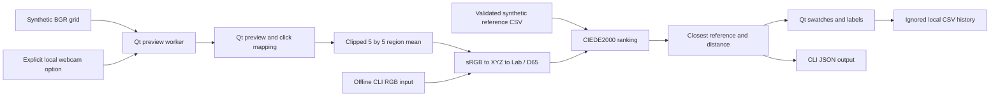

# Architecture

`ui.py` retains the desktop product/history workflow and manages preview acquisition, coordinate mapping and widgets. It connects signals before starting the worker and stops the worker when the window closes. In synthetic mode no video capture object is created. In webcam mode the selected capture is released in a `finally` block.

`color_matching.py` provides conversion, validation, matching and spatial sampling. The library schema is `ReferenceName,L_val,a_val,b_val,R,G,B`. Lab is computed from each synthetic sRGB tuple under D65; names carry no external colour-code meaning. All rows are compared on each request, which is appropriate for the small demo library.

`demo.py` invokes this core without importing Qt or opening a camera. Its default input is RGB 128,128,128. The GUI can record both clicked samples and centre-frame tests; the CLI never records history.

`examples/synthetic_products.csv` seeds `runtime/products.csv` once. Product IDs are read as strings to preserve leading zeroes. History filenames replace path separators and unsafe characters; this is a local convenience, not an access-control boundary. Product removal keeps history on disk. The original product and history records are excluded.

The application performs no network requests, machine communication or email. Dependency installation and the CI runner download public packages/actions. The optional webcam path reads a local video device only. No external configuration or secrets are necessary.

The numerical regression pair used in tests is from the [CIEDE2000 supplementary test data by Sharma, Wu and Dalal](https://hajim.rochester.edu/ece/sites/gsharma/ciede2000/). The conversion and Delta E implementations come from colour-science; this repository does not claim to implement those algorithms from scratch.
